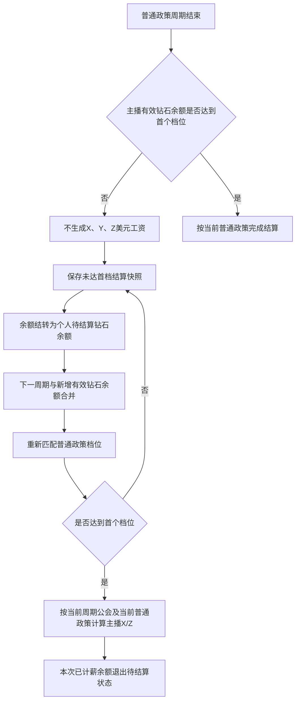
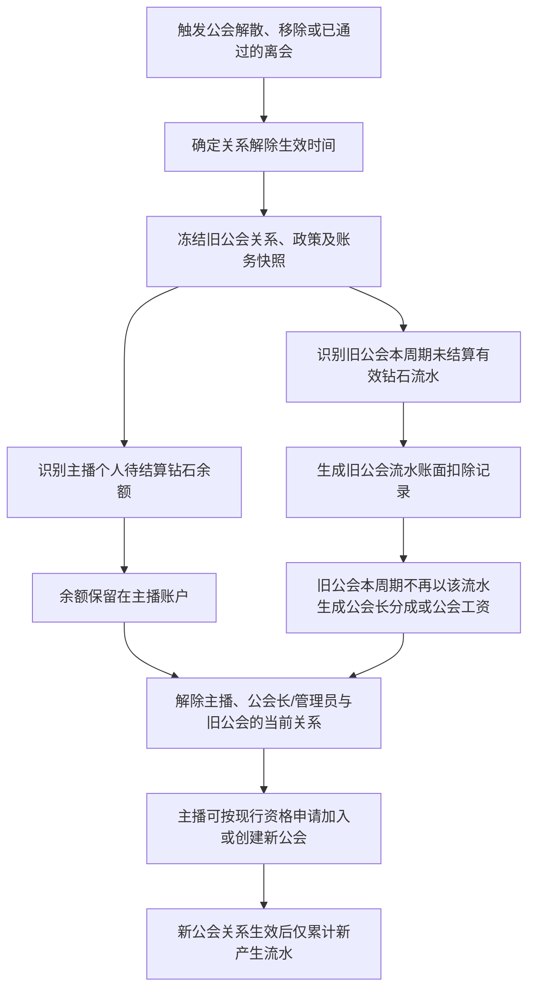
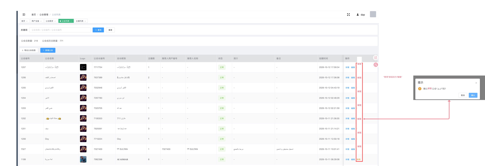
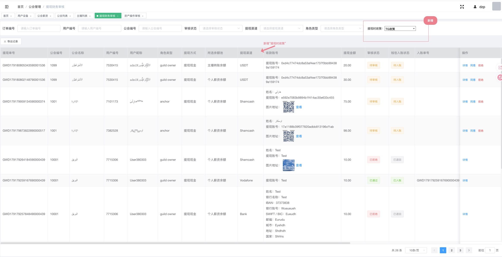

# 公会需求 1.5｜普通政策未达首档结转与跨公会钻石归属 PRD

文档版本：V1.5  
适用范围：普通政策（非自由政策）的周期结算、主播离开公会、公会解散、主播加入新公会、客户端薪资展示、后台薪资及公会账务  
版本关系：本文仅描述相对 1.0～1.4 的增量调整；除第 6.5 节明确调整的后台提现申请审核外，未明确变更的政策、工资拆分、提现、历史快照、申请审批、管理员权限及后台页面规则继续沿用现行需求。

> 本版本以用户已确认的业务决策为准：未达首档的主播钻石余额不清空；余额可跨周期累计并重新匹配档位；主播离开旧公会后余额跟随主播；旧公会期间流水不得计入新公会；新公会只统计关系生效后的新增流水；跨公会余额达档时，主播侧统一按新公会当前普通政策比例结算。

---

## 一、需求目标

### 1.1 解决的问题

| 当前问题 | 影响 | 1.5 调整目标 |
|---|---|---|
| 普通政策主播未达到首个档位时，钻石余额被清空且没有工资 | 主播已产生钻石却无法保留，争议大 | 未达首档时不清空钻石余额、不生成美元工资，余额结转至下一周期 |
| 主播离开或公会解散后，旧钻石余额与新公会流水边界不清 | 可能让旧流水在新公会重复贡献公会长分成 | 钻石余额跟随主播；钻石流水固定归属产生时的公会关系 |
| 旧公会本周期流水在成员离开后仍可能留在公会账面 | 旧公会账面可能继续产生公会长分成成本 | 离开生效后，将该主播旧公会本周期未结算流水从旧公会本周期工资账面中扣除，但保留原始流水及扣除留痕 |
| 旧余额进入新公会后无法统一结算 | 主播资产延续与新公会政策无法衔接 | 旧余额可与新公会期间新增余额合并，由新公会当前普通政策重新匹配主播档位 |

### 1.2 业务主线



---

## 二、核心对象与口径

### 2.1 核心对象定义

| 对象 | 定义 | 归属与用途 |
|---|---|---|
| 原始钻石流水 | 用户送礼等业务事件换算形成的原始钻石记录 | 永久保留用于历史、对账和追溯；不得物理删除 |
| 公会有效钻石流水 | 原始钻石流水按产生时有效公会关系、政策、周期过滤后的公会工资统计口径 | 仅用于对应公会的公会长分成 `Y`、公会账务及历史归属 |
| 主播有效钻石余额 | 主播当前可参与普通政策主播侧档位匹配的有效钻石余额 | 用于主播底薪 `X`、主播 TG 奖励 `Z` 的档位匹配 |
| 个人待结算钻石余额 | 普通政策未达首档、尚未参与美元工资结算的主播有效钻石余额 | 归主播个人；可跨周期、跨公会保留并继续参与主播侧档位匹配 |
| 已计薪钻石余额 | 已被某次主播工资结算使用并形成 `X/Z` 的余额 | 不得再次进入后续普通政策档位匹配 |
| 离会/解散归属快照 | 主播离开旧公会时冻结的关系、余额、流水与处理结果 | 用于防止后续新公会关系覆盖历史账务 |
| 流水账面扣除记录 | 将旧公会本周期未结算流水从旧公会工资账面排除的记录 | 不删除原始流水；记录扣除原因、时间、归属公会、主播及关联离会事件 |

### 2.2 不可混用的三类数值

| 数值 | 是否跟随主播 | 是否计入新公会流水 | 主要用途 |
|---|---:|---:|---|
| 原始钻石流水 | 历史可追溯，不以“跟随”表达 | 否 | 历史与对账依据 |
| 个人待结算钻石余额 | 是 | 否 | 新周期、新公会的主播侧档位匹配 |
| 新公会有效钻石流水 | 仅在新公会关系生效后产生 | 是 | 新公会公会长分成 `Y`、新公会账务 |
| 首次加入公会前已有钻石余额 | 从未加入任何公会的主播在首次入会前已持有的个人钻石余额 | 否 | 不得转换、补录或反推为首次加入公会后的公会有效钻石流水 |

**红线：** 无论主播是从旧公会转入，还是从未加入过任何公会后首次加入，公会有效钻石流水均只从该公会关系生效后开始统计。关系生效前形成的钻石余额不得被转换、补录或反推为新公会的钻石流水。

---

## 三、普通政策未达首档的结转规则

### 3.1 适用范围

- 仅适用于普通政策/非自由政策。
- 自由政策（月结）、自由政策（周结）继续按现行规则结算，不新增首档结转逻辑。
- 仅处理尚未产生美元工资的钻石余额；已结算、已计薪、已失效或已被业务规则排除的钻石不进入待结算余额。

### 3.2 周期结算规则

| 场景 | 主播有效钻石余额 | 工资处理 | 余额处理 | 公会流水账务处理 |
|---|---|---|---|---|
| 达到或超过首个档位 | 命中对应档位 | 按现行普通政策计算主播 `X/Z` 与公会长 `Y` | 本次参与主播工资计算的余额标记为已计薪，不再结转 | 按现行周期、公会归属及快照结算 |
| 未达到首个档位 | 未命中任何档位 | 本周期主播底薪 `X`、主播 TG 奖励 `Z`、公会长分成 `Y` 均为 `0 USD` | 不清空，转为个人待结算钻石余额 | 本周期不产生该主播对应的公会长分成和公会工资 |

### 3.3 下一周期重新匹配

```text
下一周期主播档位匹配余额
= 上周期个人待结算钻石余额
+ 本周期新增有效钻石余额
- 本周期已消费、已兑换、已失效或按现行规则不可参与结算的钻石余额
```

1. 每个普通政策结算周期结束时，系统读取上述“下一周期主播档位匹配余额”，重新匹配普通政策档位。
2. 该余额达到首个档位后，按**达档时所在公会的当前普通政策及当前主播比例**计算主播 `X/Z`。
3. 跨周期结转余额与当期新增余额合并后，只用于主播侧 `X/Z` 的档位匹配和工资计算；不将历史结转余额转换为任何周期、公会的新增钻石流水。
4. 达档后，本次用于主播工资计算的待结算余额须一次性完成状态迁移：`待结算 → 结算锁定 → 已计薪`。结算成功后，不得再次带入下一周期。
5. 结算失败、重复触发或人工重试时，必须复用同一结算记录；不得重复将余额结转、重复扣除余额或重复生成工资。

### 3.4 主播与公会长的计算边界

| 工资项 | 结算基数 | 未达首档时 | 跨周期达档时 |
|---|---|---|---|
| 主播底薪 `X` | 主播有效钻石余额 | `0 USD` | 使用结转余额与当期新增有效余额合并后的结果，按达档时所在公会的当前普通政策及当前 `X` 比例计算 |
| 主播 TG 奖励 `Z` | 主播有效钻石余额 | `0 USD` | 使用与 `X` 相同的主播侧档位匹配结果，按当前 `Z` 比例计算 |
| 公会长分成 `Y` | 对应公会关系期间的有效钻石流水 | `0 USD` | 仅以达档周期、达档时当前公会关系期间产生的新增有效钻石流水参与计算；历史结转余额、旧周期流水及旧公会流水不得计入 |

**说明：** 主播跨周期达档后，可能出现主播 `X/Z` 大于 `0`，而当前公会长 `Y` 为 `0` 的结果。例如：主播主要依靠历史待结算余额达到首档，但本周期新公会新增流水未达到公会长侧档位。该结果符合“余额按主播归属、流水按公会归属”的规则，不视为结算异常。

### 3.5 当前周期及历史展示

| 页面/记录 | 展示规则 |
|---|---|
| 主播当前薪资页 | 未达首档时展示本周期工资 `0 USD`、待结算钻石余额及“本周期未达到首个档位，余额已结转至后续普通政策周期”的结果说明 |
| 主播历史结算 | 读取当期快照，展示未达首档、工资为 `0 USD`、结转余额及结转结果；不得用当前余额覆盖历史值 |
| 公会薪资页 | 未达首档主播对应的主播工资、公会长分成均为 `0 USD`；不将其未达档余额作为公会工资或公会长分成基数 |
| 后台主播薪资详情 | 展示本期有效钻石余额、首档命中结果、结转前余额、结转后个人待结算钻石余额、工资为 `0 USD` 的原因及快照版本 |
| 后台公会薪资详情 | 保留该主播原始流水追溯能力，但本期公会工资账面不得计入对应 `Y` 或其他公会工资 |

---

## 四、离开旧公会后的资产与流水处理

### 4.1 统一适用的离开原因

下列任一事件使主播与旧公会关系实际解除后，均使用本章规则；不因离开原因不同改变余额迁移和新公会流水起算规则：

1. 公会解散；
2. 公会长移除主播；
3. 主播申请离开公会且申请已通过并完成关系解除。

> 公会解散可不走常规逐人离会结算流程；被移除或主播主动离会的原有申请、审批、冷却期、通知等页面流程，除本版本明确覆盖的余额/流水/账务规则外，继续沿用现行规则。

### 4.2 离开生效时的处理顺序



### 4.3 余额处理

| 项目 | 规则 |
|---|---|
| 主播个人待结算钻石余额 | 不清空，保留在主播账户并跟随主播迁移 |
| 已计薪钻石余额 | 已完成工资结算的结果继续由历史快照保留；不得回退为待结算余额 |
| 主播工资余额、金币工资余额及可提现余额 | 继续归主播本人；不随新公会转移、不被新公会接管，不回写历史工资快照 |
| 公会长本人作为主播的待结算钻石余额 | 按相同规则作为个人资产保留；不因公会解散而清空 |
| 旧余额进入新公会 | 仅可作为主播个人待结算钻石余额参与新公会后的主播侧档位匹配；不得作为新公会流水 |

### 4.4 旧公会本周期流水的账面扣除

**定义：** 账面扣除是从旧公会当期未结算的“有效钻石流水、公会长分成基数、公会工资汇总”中排除，不是物理删除原始流水，也不从主播个人钻石余额中扣除。

| 处理对象 | 处理规则 |
|---|---|
| 原始钻石流水 | 永久保留，标记产生时间、原公会、原政策、离开事件及账面扣除状态，供历史与财务追溯 |
| 旧公会本周期有效钻石流水 | 在关系解除生效后，从旧公会本周期未结算的工资账面中扣除，不进入旧公会最终有效钻石流水汇总 |
| 旧公会公会长分成 `Y` | 被账面扣除的流水不得生成、补发或保留对应 `Y` 成本 |
| 旧公会公会总薪资 | 不得包含被账面扣除流水对应的主播工资或公会长分成成本 |
| 主播个人待结算钻石余额 | 不因账面扣除而减少，仍随主播保留 |
| 已结算历史周期 | 不追溯重算；本版本仅影响关系解除时尚未完成结算的当前周期 |

### 4.5 新公会的流水与工资归属

| 项目 | 新公会处理规则 |
|---|---|
| 首次加入公会前已有钻石余额 | 从未加入任何公会的主播在首次入会前已持有的余额，不计入首次加入公会后的有效钻石流水、公会长 `Y`、公会工资、业绩或报表；不得因入会被补录为公会流水 |
| 新公会关系生效前产生的旧钻石余额 | 可作为主播个人待结算余额参与主播 `X/Z` 档位匹配 |
| 新公会关系生效前产生的旧钻石流水 | 不计入新公会有效钻石流水，不参与新公会长 `Y`，不计入新公会工资、业绩或报表 |
| 新公会关系生效后新增钻石流水 | 按新公会当前政策、关系和周期正常统计；可参与新公会长 `Y`、公会工资和新公会报表 |
| 新公会关系生效后新增钻石余额 | 与主播既有待结算余额共同参与主播侧 `X/Z` 档位匹配 |
| 新公会主播 `X/Z` 比例 | 按方案 A：统一使用新公会当前有效普通政策及该主播当前 `X/Z` 比例，不按旧公会比例拆分 |
| 新公会公会长 `Y` | 仅基于新公会关系生效后产生的新增有效钻石流水计算；历史余额和旧公会流水均排除 |

---

## 五、公会解散专项规则

### 5.1 解散处理

**对应原型：**



| 项目 | 规则 |
|---|---|
| 解散方式 | 不走逐主播普通离会结算流程，不生成新的离会工资结算 |
| 关系解除 | 批量解除公会长、管理员、主播与原公会的当前关系 |
| 成员资格 | 解散完成后，原公会长和主播可按现行规则创建公会或申请加入其他公会 |
| 钻石余额 | 主播及公会长本人待结算钻石余额保留，不清空 |
| 旧公会流水 | 解散时当前周期未结算流水从旧公会工资账面扣除，不产生旧公会公会长分成或公会工资 |
| 申请处理 | 未完成的加入申请、退出申请关闭，并记录“公会已解散”的关闭原因 |
| 历史数据 | 已结算周期的公会、成员、政策、工资、余额、提现等历史快照继续可查 |

### 5.2 解散收口快照

解散完成前必须生成不可变快照，至少包含：

- 解散公会、解散操作人、解散原因、解散时间；
- 解散时公会长、管理员、主播成员名单及角色；
- 成员关系解除生效时间；
- 当前适用政策、主播当前 `X/Z` 比例及政策版本；
- 每位主播个人待结算钻石余额、已计薪余额状态；
- 当前周期原始钻石流水、账面扣除流水及扣除原因；
- 已生成工资、已生成余额池、提现申请、冻结或失败回滚中的资金状态；
- 已关闭申请及关闭原因；
- 批量解绑执行结果与失败重试结果。

---

## 六、客户端与后台需求

### 6.5 后台提现申请审核

**本节仅描述原型图红色“新增”标注的改动。** 未标注的审核状态、收款账号、同意/拒绝、入账状态、分页、权限及原有审核处理规则继续沿用现行需求。



#### 6.5.1 改动总览

| 改动位置 | 新增内容 | 规则 |
|---|---|---|
| 筛选区 | 提现时政策 | 独立多选筛选项；默认“全部” |
| 提现申请列表 | 提现时政策 | 展示该笔提现申请发起时的结算政策 |
| 导出记录 | 提现时政策 | 导出结果与当前列表筛选一致，并包含该字段 |

#### 6.5.2 筛选区

| 字段名称 | 控件 | 默认值 | 可选值 | 筛选规则 |
|---|---|---|---|---|
| 提现时政策 | 多选下拉框 | 全部 | TG政策、自由政策（月结）、自由政策（周结） | 未选择具体政策或选择“全部”时不按政策过滤；选择一个或多个具体政策时，返回提现时政策属于任一已选项的记录 |

- 位置：与“审核状态”“提现渠道”“角色类型”同级，位于“角色类型”之后。
- 该筛选项仅筛选当前列表数据，不改变提现申请、审核、打款或余额处理规则。

#### 6.5.3 提现申请列表

| 列名称 | 位置 | 展示规则 |
|---|---|---|
| 提现时政策 | 位于“提现渠道”之后、“收款账号”之前 | 显示该笔提现申请发起时的结算政策；列表按申请记录中保存的政策结果展示，不因后续政策变更改写已存在申请的展示结果 |

#### 6.5.4 导出记录

- 点击“导出记录”时，导出范围沿用当前列表的全部筛选条件。
- 导出字段新增“提现时政策”，字段值与列表同一笔提现申请的展示结果一致。
- 同一导出任务中，列表与导出的政策筛选口径必须一致；不得出现列表已按政策过滤、导出未按该条件过滤的情况。

---

## 七、状态、快照与幂等

### 7.1 待结算钻石余额状态

| 状态 | 进入条件 | 可执行处理 | 退出条件 |
|---|---|---|---|
| 正在累计 | 当前普通政策周期内生成可参与主播侧结算的有效余额 | 等待周期结算或关系解除 | 周期结算、离开旧公会、余额失效或已消费 |
| 待结算 | 未达到首档，且本周期未生成美元工资 | 结转至后续周期；可随主播迁移 | 后续达档结算、失效或按现行资产规则消耗 |
| 结算锁定 | 已达到首档并开始生成主播工资 | 禁止再次进入其他结算任务 | 结算成功进入已计薪；失败恢复待结算 |
| 已计薪 | 已形成主播 `X/Z` 工资并写入结算快照 | 仅支持历史追溯 | 不可回退为待结算 |

### 7.2 流水账面扣除状态

| 状态 | 说明 |
|---|---|
| 原始已记录 | 原始钻石流水存在，尚未因关系解除影响公会账面 |
| 已账面扣除 | 已从旧公会当前周期未结算工资账面中排除，不生成旧公会 `Y` 或公会工资 |
| 历史已结算 | 已结算周期的历史流水，不因本版本离开规则追溯扣除或重算 |

### 7.3 幂等规则

1. 同一主播、同一普通政策周期、同一待结算余额批次，只能生成一条未达首档结转结果。
2. 同一待结算余额批次只能被一个主播工资结算任务成功消费一次。
3. 同一离开事件、同一主播、同一旧公会、同一周期，只能生成一条流水账面扣除记录。
4. 结算重试、解散批量任务重试、离会处理重试必须读取既有快照和既有状态，不得重复扣除旧公会账面，也不得重复生成主播工资。
5. 新公会关系生效前的流水不得因关系补录、页面查询、导出重跑或后台重算被归入新公会。

---

## 八、异常与边界规则

| 场景 | 处理规则 |
|---|---|
| 未达首档后下一周期仍未达首档 | 不生成工资，继续保留并结转符合条件的待结算余额 |
| 结转余额达到首档，但本周期新增流水为 0 | 可按方案 A 生成主播 `X/Z`；新公会长 `Y` 为 `0 USD` |
| 主播离开后未立即加入新公会 | 待结算余额继续归主播个人保留；不产生任何公会流水或公会长分成 |
| 主播从未加入过公会后首次入会 | 入会前已有钻石余额不得计入首次加入公会后的有效钻石流水、公会长 `Y`、公会工资、业绩或报表；该公会仅统计关系生效后新增的有效钻石流水 |
| 主播在同一周期内多次变更公会 | 每次关系解除均冻结旧关系并执行旧公会未结算流水账面扣除；最终新公会仅统计其关系生效后的新增流水；不得跨公会重复计算 |
| 主播离开前当前周期已完成结算 | 已结算历史不重算；已计薪余额不进入待结算迁移；本版本仅对尚未结算的当前周期生效 |
| 公会解散批量解绑部分失败 | 成功成员保留快照和处理结果；失败成员维持“解散处理中”，重试只处理未成功成员，不重复处理成功成员 |
| 当前新公会政策不是普通政策 | 旧待结算余额不得被自动带入自由政策公式；待主播再次进入适用普通政策的结算范围时再按规则处理 |
| 新公会修改主播 `X/Z` 比例 | 仅影响修改生效后的未结算主播工资；已生成结算快照不追溯。跨公会结转余额达档时，读取结算时的新公会当前有效比例 |
| 提现、冻结或回滚发生在余额结转后 | 不得改写历史未达首档快照；是否影响当前可参与结算余额，按现行资产有效性规则处理 |

---

## 九、系统消息

### 9.1 未达首档结转

| 接收人 | 场景 | 标题 | 正文 | 触发条件 |
|---|---|---|---|---|
| 主播 | 普通政策未达首档 | 本期钻石余额已结转 | 你本期未达到普通政策首个档位，未生成薪资。符合条件的钻石余额已保留 | 本周期结算完成且生成待结算余额结转结果 |

### 9.2 公会解散与关系解除

| 接收人 | 场景 | 标题 | 正文 | 触发条件 |
|---|---|---|---|---|
| 主播 | 公会解散后关系解除 | 公会成员关系已解除 | 你所在的公会「{公会名称}」已解散，你的成员关系已解除。未结算的符合条件钻石余额已保留。 | 解散批量解绑成功 |
| 主播 | 被移出公会后关系解除 | 公会成员关系已解除 | 你已被移出公会「{公会名称}」。未结算的符合条件钻石余额已保留。 | 移除流程完成并实际解除成员关系 |
| 主播 | 主动离会完成 | 已退出公会 | 你已成功退出公会「{公会名称}」。未结算的符合条件钻石余额已保留。 | 退出申请通过且实际解除成员关系 |

**通知边界：** 消息只在关系实际解除或结转结果实际生成后发送；重复结算、重复解绑、重试任务不得重复发送。消息不得将余额保留描述为已生成工资、已可提现金额或新公会流水。

---

## 十、影响范围与沿用规则

### 10.1 被本版本覆盖的旧口径

| 旧口径 | 1.5 替换口径 |
|---|---|
| 普通政策未达到首档后清空钻石余额 | 未达到首档时不清空，转为个人待结算钻石余额并结转至后续普通政策周期 |
| 离会结算后清空已结算周期钻石余额 | 仅已参与工资结算的余额按已计薪状态处理；未达首档、未产生工资的待结算余额不得清空 |
| 新公会只影响离会后新产生的流水、工资和政策归属 | 新公会仅统计关系生效后的新增流水；主播旧余额可参与主播侧 `X/Z` 档位匹配，但不得成为新公会流水或新公会长 `Y` 基数 |
| 旧公会当前周期流水可继续保留在工资账面 | 主播关系解除后，旧公会当前周期未结算流水从旧公会工资账面扣除，不产生旧公会工资成本 |

### 10.2 继续沿用的规则

- 普通政策主播 `X/Z` 看主播有效钻石余额、公会长 `Y` 看有效钻石流水的双基数结构；
- 每个工资项先拆金币工资与非金币工资，再按角色和公会汇总；
- 已结算历史读取当期政策、归属、输入和工资结果快照，不按当前关系或当前配置重算；
- 主播工资余额、金币工资余额、提现、冻结、失败回滚及后台权限继续沿用现行规则；
- 主播退出申请、公会长审核、管理员权限、冷却期与系统消息中未被本版本明确改写的部分继续沿用 1.0～1.4。


---

## 十一、最终口径

1. 普通政策未达首档时，主播钻石余额不清空；本周期 `X/Y/Z` 均不生成美元工资，符合条件的余额结转至后续普通政策周期重新匹配档位。
2. 主播离开旧公会后，未计薪钻石余额跟随主播；该余额可在新公会作为主播侧余额参与 `X/Z` 档位匹配。
3. 钻石流水按产生时的公会关系归属。无论主播从旧公会转入，还是从未加入过公会后首次加入，当前公会都只统计关系生效后新增的有效钻石流水；关系生效前的钻石余额及旧流水均不计入当前公会有效钻石流水，不参与当前公会长 `Y`。
4. 主播因公会解散、被移出或主动离开而解除旧公会关系后，旧公会当前周期尚未结算的流水须从旧公会工资账面扣除，避免产生旧公会公会长分成及公会工资成本；原始流水不删除，必须可追溯。
5. 跨公会结转余额达档时，主播 `X/Z` 统一按新公会当前有效普通政策及当前比例结算；新公会长 `Y` 只按主播加入新公会后新增有效流水计算。
